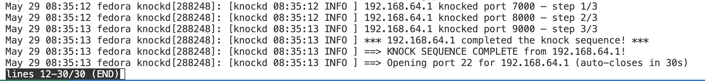

# knockd

A port knocking daemon for Linux, in C.

The protected port stays closed in your firewall. When a client sends
packets to a configured sequence of ports in the right order, knockd adds
an `iptables` ACCEPT rule for that one source address and removes it again
after a timeout. Both TCP SYN and UDP knocks work.

The daemon reads packets from an `AF_PACKET` socket rather than binding
anything, so it adds no listening socket of its own and a port scan of the
host will not find it.

---

## What this does and does not protect against

Port knocking hides a service behind a shared secret that is sent in
cleartext. That is worth something, and it is worth being precise about
what:

**It helps with**

- Automated scanning and credential stuffing. A closed port gets no
  attention from the botnets that work through the internet's SSH servers
  all day, which also keeps your auth log readable.
- Reducing exposure to an unpatched service. If a zero-day in sshd is
  announced at 3am, the port being closed buys you time.

**It does not help with**

- **Anyone who can observe your traffic.** The sequence is a static secret
  in the clear. An on-path observer, a compromised router, a shared Wi-Fi
  network, or your ISP can read it off the wire and replay it afterwards.
  There is no nonce, no timestamp and no HMAC, so a recorded sequence works
  forever. If you need that, use
  [fwknop](https://github.com/mrash/fwknop), which does single packet
  authorization properly.
- **Shared addresses.** The grant is per source IP. While it is open,
  anything behind the same NAT or VPN exit as you can reach the port too.
- **Someone who already has your credentials.** This is a layer in front of
  authentication, not a substitute for it. Keep key-only SSH, keep
  `PermitRootLogin no`, keep fail2ban.

knockd also only handles IPv4. If the host accepts IPv6, the protected port
is reachable over IPv6 regardless of what knockd is doing, so block it
there too (`ip6tables`) or the whole exercise is decorative.

---

## How it works

```
client                                    server
  |                                         |
  |-- SYN -> 7000 --------------------------> capture thread
  |-- SYN -> 8000 -------------------------->   parses the packet, queues it
  |-- SYN -> 9000 -------------------------->
  |                                              |
  |                                         processor thread
  |                                           tracks progress per source IP
  |                                           on the last knock:
  |                                             iptables -I KNOCKD
  |                                               -s <client> --dport 22 -j ACCEPT
  |                                              |
  |-- SSH ----------------------------------->  allowed
  |                                              |
  |                                         30 seconds later
  |                                           the rule is removed
```

Two threads, because opening the firewall means `fork()` and `exec()` of
`iptables`, which takes milliseconds. Doing that on the capture path would
let the socket's receive buffer overflow and lose other clients' knocks
while it ran. So the capture thread only parses and enqueues, and a
processor thread does everything slow.

Grant expiry is driven from the processor loop rather than from a timer
thread per grant, which keeps a knock flood from spawning unbounded
threads.

### knockd's rules live in their own chain

At startup knockd creates an iptables chain called `KNOCKD` and inserts
`INPUT -j KNOCKD` at the top. Every rule it adds goes in that chain.

This matters because iptables deletes rules by matching their
specification, not by identity. If knockd put its rules straight into
`INPUT`, expiring a grant for `10.0.0.5` would delete whichever matching
rule came first, which could be a permanent one you added by hand.

On shutdown knockd flushes and removes its own chain and nothing else.
**Stopping the daemon closes the protected port, it does not open it** —
your own DROP rule is untouched.

---

## Requirements

Linux, and root. The capture socket needs `CAP_NET_RAW` and iptables needs
`CAP_NET_ADMIN`.

```bash
# Fedora / RHEL
sudo dnf install gcc make iptables-nft nmap-ncat

# Debian / Ubuntu
sudo apt install build-essential iptables netcat-openbsd
```

`nmap` is not needed. `nc` is only needed on the machine you knock *from*.

---

## Build and install

```bash
make
sudo make install
```

That installs `/usr/local/bin/knockd`, the systemd unit, and
`/etc/knockd.conf` with mode 600. An existing `/etc/knockd.conf` is never
overwritten, so reinstalling will not lose your sequence.

`make install` honours `DESTDIR` and `PREFIX`.

### Configure

Edit `/etc/knockd.conf`:

```ini
sequence    = 7000, 8000, 9000   # 2-16 ports, in the order to knock them
port        = 22                 # the port to open
timeout     = 30                 # seconds the port stays open
window      = 15                 # max seconds between consecutive knocks
max_clients = 64                 # concurrent sequences and grants tracked
# interface = eth0               # unset watches every interface
log_level   = 2                  # 0 errors, 1 warnings, 2 normal, 3 debug
```

**Change the sequence before you start.** The default is published in this
file, in the example config and in the paragraph above, so leaving it is
equivalent to running no sequence at all.

A value that is missing, unparseable or out of range falls back to its
built-in default and says so in the log. The sequence is stricter: one bad
port rejects the whole list, because listening on a half-parsed version of
a secret is worse than refusing it.

The config file is the only secret here, so keep it to root:

```bash
sudo chmod 600 /etc/knockd.conf
```

knockd warns at startup if anyone else can read it. It also withholds the
sequence from its own startup banner unless you pass `-v`, because under
systemd the log goes to the journal, which more users can read than can
read `/etc/knockd.conf`.

---

## Set up the firewall

knockd adds the ACCEPT rules. Blocking the port in the first place is your
job, and knockd never touches that rule.

> Add the first rule **before** the second, or you will disconnect your own
> SSH session.

```bash
# Keep connections that are already established
sudo iptables -I INPUT 1 -m conntrack --ctstate ESTABLISHED,RELATED -j ACCEPT

# Block new connections to the protected port
sudo iptables -A INPUT -p tcp --dport 22 -j DROP
```

Neither rule survives a reboot on its own. Persist them:

```bash
# Debian / Ubuntu
sudo apt install iptables-persistent && sudo netfilter-persistent save

# Fedora / RHEL
sudo dnf install iptables-services && sudo service iptables save
```

**If firewalld is running** (the default on Fedora) it owns the ruleset,
and a `firewall-cmd --reload` will discard both these rules and knockd's
chain. Either manage the DROP through firewalld, or disable firewalld and
manage iptables directly. Restart knockd after anything that reloads the
firewall, since it only installs its chain at startup.

Leave the knock ports themselves closed, not DROPped. See
[Why nc, not nmap](#why-nc-not-nmap).

---

## Run

Under systemd, which is what the unit file is for:

```bash
sudo systemctl enable --now knockd
sudo systemctl status knockd
```

Or directly, which is useful for testing against a local config:

```bash
sudo ./knockd -c ./knockd.conf.example -v
```

```
  -c, --config <file>  Config file (default: /etc/knockd.conf)
  -v, --verbose        Debug logging; overrides log_level
  -s, --syslog         Log to syslog instead of stderr
  -V, --version        Print the version and exit
  -h, --help           Print this help and exit
```

knockd runs in the foreground and expects to be supervised. A config file
named with `-c` must exist: knockd refuses to start rather than silently
fall back to the default sequence.

---

## Knock

With the included client, from the machine you want to connect from:

```bash
./knock_client.sh <server>                          # knock
./knock_client.sh <server> --ssh                    # knock, then ssh
./knock_client.sh <server> --ssh admin              # ssh as a given user
./knock_client.sh <server> -p 1111,2222,3333        # a different sequence
./knock_client.sh <server> -p ... -P 2222 --ssh     # sshd on another port
./knock_client.sh <server> --udp                    # UDP instead of TCP SYN
./knock_client.sh <server> -d 0.3                   # delay between knocks
```

The port list has to match the server's. A wrong port does not merely fail,
it discards whatever progress the sequence had made.

By hand, with `nc`:

```bash
for p in 7000 8000 9000; do nc -w 1 <server> "$p" </dev/null; sleep 0.5; done
ssh user@<server>
```

### Logs

```bash
sudo journalctl -u knockd -f        # follow
sudo journalctl -u knockd -n 50     # recent
```

At the default log level knockd records progress as "is at step 2 of 3"
without naming the port, so the journal does not leak the sequence. Level 3
(or `-v`) logs the ports, which is why it is a debugging setting rather
than a permanent one.

---

## Why nc, not nmap

Both can send a TCP SYN, but they leave the connection in different states,
and that changes what the server sees.

`nmap` does not complete the handshake. The kernel on the *client* side
treats its own SYN as unanswered and retransmits it after one to three
seconds. That retransmit reaches the server as a second knock on the same
port — out of sequence, and in a naive implementation enough to reset your
progress. `nc` completes a `connect()`, gets an RST back from the closed
port, and the kernel has nothing left to retransmit.

knockd ignores a repeat of the port it just accepted for five seconds, so a
retransmit does not break a sequence either way. `nc` is still the better
tool, and it is the only one of the two that can send a UDP knock without
root.

This is also why the knock ports should be **closed, not DROPped**. A
closed port answers with an RST and the client's kernel stops. A DROPped
port answers with nothing, so the client's kernel retransmits exactly as it
does for `nmap`. Leave the knock ports out of your DROP rules.

---

## Development

```bash
make              # build
make strict       # full warning set, warnings as errors (what CI runs)
make debug        # -O0, symbols, AddressSanitizer and UBSan
make test         # unit tests for the state machine and the config parser
sudo tests/integration.sh   # end-to-end against the real firewall
```

The integration test starts the daemon, knocks at it over loopback, and
checks the resulting iptables state at each step: that an out-of-order
sequence is rejected, that the right one opens the port, that access
expires on its own, and that shutdown removes knockd's chain while leaving
the operator's DROP rule in place. It only ever uses port 2222 and cleans
up after itself, including on failure.

### Layout

| File | |
|---|---|
| [src/main.c](src/main.c) | argument handling, threads, the processor loop |
| [src/sniffer.c](src/sniffer.c) | raw socket, link/IP/TCP/UDP parsing |
| [src/knocker.c](src/knocker.c) | per-IP sequence state machine |
| [src/firewall.c](src/firewall.c) | the `KNOCKD` chain and grant expiry |
| [src/packet_queue.c](src/packet_queue.c) | bounded queue between the threads |
| [src/config.c](src/config.c) | config parsing and validation |
| [src/logger.c](src/logger.c) | leveled logging to stderr or syslog |

---

## Verbose output



---

## Troubleshooting

| Symptom | What to check |
|---|---|
| `Failed to create raw socket` | You are not root, or not on Linux. |
| `Could not create or flush the KNOCKD chain` | `iptables -L` works as root; on Fedora, `dnf install iptables-nft`. |
| Knocks are not detected at all | `sudo tcpdump -i any port 7000` on the server, to see whether the packets arrive. If they do not, something upstream is dropping them. |
| Knocks are detected but the sequence keeps resetting | Use `nc`, not `nmap`, and make sure the knock ports are not in a DROP rule. |
| The sequence completes but the port is still blocked | `sudo iptables -S KNOCKD` should list an ACCEPT for your address. If it does, your DROP rule is probably above the `INPUT -j KNOCKD` jump: check `sudo iptables -S INPUT`. |
| It worked, then stopped after a firewall change | A firewalld or iptables reload discards knockd's chain. `systemctl restart knockd`. |
| `iptables` commands in the log fail under systemd | The unit file applies `SystemCallFilter`, `MemoryDenyWriteExecute` and `ProtectSystem`. If iptables misbehaves under it, comment those out one at a time to find which. |
| Access expires at slightly the wrong time | Expiry is checked a few times a second and timestamps have one-second granularity, so a rule's real lifetime lands within about a second of `timeout`. An SSH connection that is already established survives the rule being removed. |
| Everything works but anyone can still reach the port | Check IPv6: `sudo ip6tables -S`. knockd is IPv4 only. |
